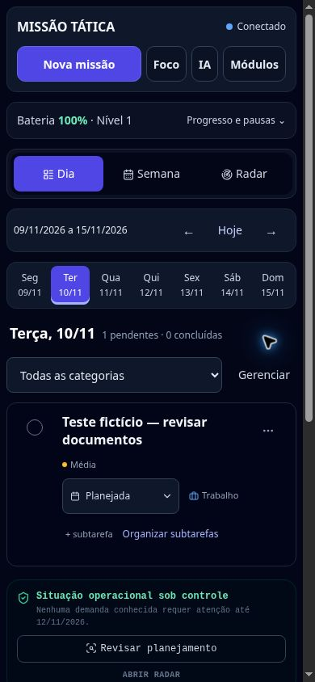

# UX — primeira etapa (v1.9.78)

## Comportamento entregue

- Cabeçalho compacto com Nova missão, Foco, IA e Módulos; perfil e saída estão em Módulos.
- Bateria, relógio e progresso ficam em um resumo expansível. Os sete dias cabem em telas de 320 e 390 px. Categorias usam um seletor com rótulo acessível.
- No celular, o atalho de foco da missão está no menu Mais ações, junto da reordenação por botões. O espaço liberado favorece o título.
- Formulários compartilhados ocupam a tela no celular, têm área de rolagem identificada, botões de 44 px e campos de 16 px. Energia e recompensas ficaram em uma seção opcional na criação.
- Cadastro manual de missões oferece Continuar cadastrando: mantém data, categoria, duração e prioridade; limpa título, subtarefas, horários e vínculos. Não aparece nas propostas da IA nem na conversão do Google Agenda.
- Fechar os formulários de missão (nova/edição) e RADAR após digitar ou selecionar solicita descarte. Cancelar a confirmação mantém o preenchimento.
- Preservação compartilhada de posição, foco e cursor durante reconstruções. Retorno ao controle de origem ao fechar uma janela, inclusive botões sem ID quando sua ação é única. Rolagem do fundo bloqueada com diálogos sem perder a posição de retorno.
- Finanças e Corpo mantêm o formulário aberto e a página da lista após registro. Campos do registro salvo são limpos pelo mecanismo de rascunhos existente.
- Concluir missão vinculada deixa uma sugestão opcional Atualizar RADAR. As opções só abrem por iniciativa do usuário. Nenhum status do RADAR é alterado automaticamente.
- Trocar dia ou filtro não grava o estado da campanha nem agenda sincronização. Preferências de navegação continuam no estado em memória e acompanham o próximo salvamento de dados; não há garantia de persistência de navegação isolada após recarregar.
- Relógio é atualizado imediatamente após renderizar, com atualização por minuto, sem o placeholder reaparecer por um segundo.
- Inteligência usa Dia selecionado, evitando chamar de Hoje um dia de outra data.

## Dados e compatibilidade

Sem migração. Nenhuma coleção Firebase, regra de segurança, credencial, perfil, campanha, histórico, recompensa, vínculo ou contrato da integração IA foi alterado. Versões anteriores dos módulos de interface continuam disponíveis. Prévia usa somente registros fictícios e simulação de autenticação/persistência.

## Validação

- `npm test`: 487 testes, 487 aprovados, zero falhas.
- `git diff --check`: aprovado.
- Testes novos: navegação sem gravações; estado/paginação de Finanças e Corpo; criação contínua e exclusão desse fluxo em IA/Agenda; sugestões RADAR sem mutação; menu de módulos; foco de retorno; rolagem por semana; descarte cancelável; foco por ação sem ID.
- Teste de recorrência já existente passou a fixar o relógio também no módulo importado, evitando depender da data real da execução. Nenhuma regra de recorrência mudou.
- Navegador: desktop, 390×844 e 320×740; criação e reabertura de missão, cadastro contínuo, cancelamento de descarte, receita com formulário aberto e acesso ao foco pelo menu móvel.
- Não houve teste autenticado contra Firebase de produção, dispositivo físico, teclado virtual ou leitor de tela. Não há medição de latência de produção nesta entrega.

## Próxima etapa

Atualização parcial do DOM ainda não implementada. A arquitetura principal continua reconstruindo a interface; esta etapa preserva contexto, reduz trabalho desnecessário de navegação e elimina a animação repetida de diálogos identificados. A mudança de módulos grandes para áreas de trabalho próprias, revisão ampla de textos/contraste e refinamento dos alertas RADAR permanecem no plano.

A proteção de descarte cobre os três formulários compartilhados; não é uma proteção universal contra fechamento da aba ou todos os editores internos.

